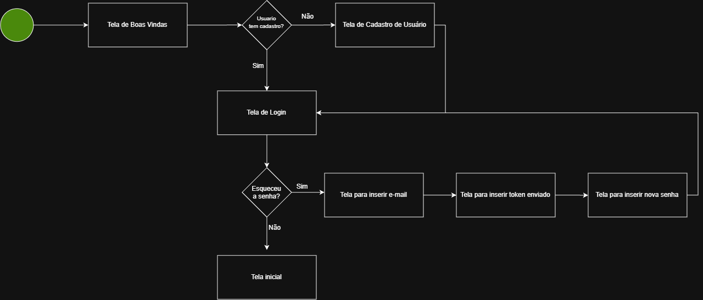
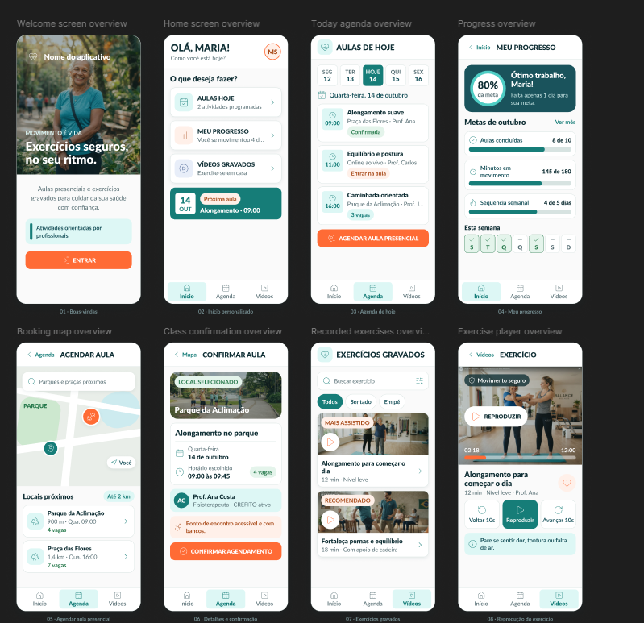

# 💻 Vital Senior — Sistema Mobile Web de Exercícios Físicos para a Terceira Idade

> **Instituição:** Universidade São Judas Tadeu (USJT)  
> **Curso:** Bacharelado em Sistemas de Informação  
> **Disciplina:** Gestão e Qualidade de Software (A3) — 2026  
> **Professor Orientador:** Lawilson  
> **Tema:** Solução Computacional para Saúde, Mobilidade Urbana e Preservação do Meio Ambiente Urbano

---

## 👥 Integrantes e Responsabilidades

| Integrante | RA | Responsabilidade Principal |
|------------|----|----------------------------|
| **Leonardo do Amaral Quinquio** | `824143195` | Modelagem e Implementação de Software |
| **Luighi Cordeiro Gaspareto** | `824117584` | Documentação do Sistema e Engenharia de Requisitos |
| **Henrique Matias de Oliveira** | `824130738` | Documentação, Gerenciamento de Projeto e Requisitos |
| **Enzo Yukio Yoshida** | `8261105032` | Modelagem de Software e Implementação |
| **Guilherme Sales de Andrade** | `825125938` | Engenharia de Requisitos e Implementação |

---

## 🔗 Links Úteis e Artefatos do Projeto

- 📌 **Gerenciamento Ágil (Jira):** [Board Scrum/Kanban do Projeto](https://leonarddoamaral.atlassian.net/jira/software/projects/SCRUM/boards/1?filter=&groupBy=none&atlOrigin=eyJpIjoiMjQ4YjY2YWE0N2Q4NDk5YjlhOGFhMjg0YmNhMjMyMzIiLCJwIjoiaiJ9)
- 📄 **Documentação Técnica Completa:** [Documento Oficial (Google Docs)](https://docs.google.com/document/d/1hpNqKnNYzCt4uGbLoLLl9dWYgMm7M_wSo3EddKcJpcA/edit?usp=sharing)
- 📐 **Diagramas e Protótipos:** Disponíveis na pasta `./Docs` deste repositório.

---

## 📃 Sobre o Projeto e Contextualização

O **Vital Senior** é um sistema **mobile web** voltado à população idosa e a pessoas com mobilidade reduzida. Segundo dados da Organização Mundial da Saúde (WHO, 2024), cerca de 31% dos adultos não atingem os níveis recomendados de 150 minutos semanais de atividade física moderada — índice que tende a crescer após os 60 anos.

Aliado a esse cenário, observa-se a subutilização e degradação de parques e praças públicas. A plataforma atua como ponte entre a comunidade, profissionais de Educação Física e espaços urbanos públicos, reunindo em uma interface acessível:
- Localização georreferenciada de parques e praças públicas próximas;
- Agendamento e cancelamento de aulas presenciais ao ar livre;
- Preenchimento de ficha de saúde/mobilidade e contato de emergência (em conformidade com a LGPD — Lei nº 13.709/2018);
- Catálogo de exercícios demonstrativos em vídeo;
- Avaliação rápida pós-aula e acompanhamento de frequência.

> **Aviso:** A plataforma apoia a organização, divulgação e acesso às atividades físicas, não substituindo avaliação médica ou acompanhamento presencial de profissionais de saúde.

### 🌱 Alinhamento Socioambiental e ODS (ONU)
- **Problema Enfrentado:** Sedentarismo e isolamento social da população idosa somados à subutilização de espaços públicos urbanos.
- **ODS 3 (Saúde e Bem-Estar):** Prevenção de doenças crônicas e quedas, fortalecimento muscular e suporte à saúde mental.
- **ODS 11 (Cidades e Comunidades Sustentáveis):** Estímulo à ocupação ativa, convívio comunitário e conservação de parques e praças.
- **ODS 13 (Ação Contra a Mudança Global do Clima):** Incentivo à mobilidade ativa e ao uso sustentável da infraestrutura urbana do bairro.

---

## 🛠️ Stack Tecnológica e Arquitetura

A solução adota uma **arquitetura cliente-servidor em camadas**, com frontend independente, API REST monolítica e banco de dados relacional, inteiramente conteinerizada com **Docker Compose**:

| Camada | Tecnologia | Papel no Sistema |
|--------|------------|------------------|
| **Frontend** | React, TypeScript, Vite, OpenLayers, Lucide Icons | Interface mobile web responsiva, de alto contraste e navegação simplificada, com mapas interativos. |
| **Backend** | Java 17, Spring Boot 3, Spring Web, Spring Security, Spring Data JPA | Exposição da API REST (`/vitalsenior/**`), regras de negócio, criptografia de senhas (BCrypt) e controle de CORS. |
| **Banco de Dados** | PostgreSQL 16 | Persistência relacional com integridade referencial e volume persistente. |
| **Infraestrutura** | Docker, Docker Compose, Nginx | Padronização do ambiente de execução, build multi-stage e proxy/servidor estático do frontend. |

### Estrutura do Repositório

```text
A3-Gest-o-Qualidade-Software/
├── demo/                   # Backend Java 17 + Spring Boot 3 (API REST e DataSeeder)
│   ├── Dockerfile
│   └── pom.xml
├── vital-senior/           # Frontend React + TypeScript + Vite
│   ├── Dockerfile
│   ├── nginx.conf
│   └── package.json
├── Docs/                   # Diagramas UML (Casos de Uso, Classes, Fluxos) e Protótipos UI/UX
├── docker-compose.yml      # Orquestração dos containers (db, backend e frontend)
└── README.md
```

---

## 🚀 Como Executar o Projeto (Ambiente Docker)

O projeto está configurado para rodar com **um único comando**, subindo automaticamente o banco PostgreSQL (já populado pelo `DataSeeder`), a API Spring Boot e o frontend React.

### Pré-requisitos
- [Docker Desktop](https://www.docker.com/products/docker-desktop/) instalado e em execução.

### Passo a passo

1. **Clone o repositório e entre na pasta raiz:**
   ```bash
   git clone https://github.com/leonarddoamaral/A3-Gest-o-Qualidade-Software.git
   cd A3-Gest-o-Qualidade-Software
   ```

2. **Construa e inicie os containers:**
   ```bash
   docker compose up --build -d
   ```

3. **Verifique se os 3 containers estão ativos (`Up`):**
   ```bash
   docker compose ps
   ```

4. **Acesse a aplicação no navegador:**
   - **Aplicação Web (Frontend):** [http://localhost:3000](http://localhost:3000)
   - **API REST (Backend):** [http://localhost:8081](http://localhost:8081)

### 🔐 Credenciais de Teste (Pré-cadastradas)

Na inicialização, a classe `DataSeeder` popula o banco com locais reais da região da Mooca (**Parque da Mooca** e **CEE Salim Farah Maluf**), aulas agendadas, vídeos demonstrativos e dois perfis prontos para demonstração:

| Perfil | E-mail | Senha |
|--------|--------|-------|
| **Aluno (Sênior)** | `jose@vitalsenior.com` | `123456` |
| **Professor (Profissional)** | `ana@vitalsenior.com` | `123456` |

---

## 🔄 Gerenciamento do Projeto, Ciclo de Vida e Riscos

### Ciclo de Vida e Ferramentas
O desenvolvimento foi conduzido em **Sprints semanais** combinando práticas de **Scrum e Kanban**:

| Etapa | Atividades | Ferramentas |
|-------|------------|-------------|
| **Planejamento e Análise** | Levantamento de requisitos, definição de escopo MVP e gestão de Sprints. | Jira, Obsidian e Microsoft Teams |
| **Projeto e Arquitetura** | Modelagem conceitual/relacional, diagramação UML e prototipação acessível. | Figma e Draw.io |
| **Programação** | Implementação em camadas (Backend) e componentização (Frontend). | VS Code, IntelliJ IDEA e GitHub |
| **Testes e Qualidade** | Validação funcional dos fluxos críticos, CORS, persistência e usabilidade. | Docker Compose (Homologação local) |
| **Gerência de Configuração** | Controle de versão distribuído, padronização de ambientes e migração/seed de dados. | GitHub e Docker |

### Matriz de Principais Riscos e Mitigações (P × I)
Avaliados em escala de 1 a 5 ($\text{Nível} = P \times I$):

| ID | Risco | Nível | Classificação | Estratégia de Mitigação Adotada |
|----|-------|-------|---------------|---------------------------------|
| **R01** | Vazamento de dados pessoais e de saúde | `20` | Crítico | Armazenamento restrito, hash de senhas (`BCrypt`) e aderência à LGPD. |
| **R02** | Acesso não autorizado entre perfis | `20` | Crítico | Segregação de rotas e fluxos por `tipoPerfil` (`ALUNO` vs. `PROFISSIONAL`). |
| **R03** | Indisponibilidade do ambiente de execução | `20` | Crítico | Conteinerização completa com `healthcheck` no PostgreSQL via Docker Compose. |
| **R06** | Conflitos nos agendamentos de aulas | `12` | Alto | Validação de unicidade por aluno/aula e atualização de status no backend. |
| **R09** | Falhas de usabilidade para o público idoso | `16` | Alto | Tipografia ampliada, alto contraste, botões espaçados e confirmação dupla. |

---

## 📐 Engenharia de Requisitos

### Requisitos Funcionais (RF)

| ID | Requisito | Descrição | Status |
|----|-----------|-----------|--------|
| **RF-01** | Cadastro de Usuário | Cadastro com nome completo, data de nascimento, telefone, e-mail, senha e seleção de perfil. | ✅ Implementado (MVP) |
| **RF-02** | Autenticação de Usuário | Login por e-mail e senha com validação via Spring Security. | ✅ Implementado (MVP) |
| **RF-03** | Controle de Perfis de Acesso | Segregação de funcionalidades entre **Aluno**, **Professor** e **Administrador**. | ✅ Implementado (MVP) |
| **RF-04** | Gestão de Locais Públicos | Cadastro e listagem de praças e parques públicos com coordenadas geográficas. | ✅ Implementado (MVP) |
| **RF-05** | Recomendação por Geolocalização | Mapa interativo (OpenLayers) com localização do usuário e filtro de espaços próximos. | ✅ Implementado (MVP) |
| **RF-06** | Agendamento e Cancelamento | Agendamento de aulas pelo aluno e cancelamento (pelo aluno ou pelo professor com motivo). | ✅ Implementado (MVP) |
| **RF-07** | Painel de Aulas do Dia | Dashboard inicial personalizado por perfil com acesso rápido às aulas e atividades. | ✅ Implementado (MVP) |
| **RF-08** | Ficha de Mobilidade e Anamnese | Registro de restrições físicas (dores no peito, quedas, articulações) e contato emergencial. | ✅ Implementado (MVP) |
| **RF-09** | Catálogo de Exercícios com Mídia | Biblioteca de exercícios com instruções, precauções e vídeos demonstrativos. | ✅ Implementado (MVP) |
| **RF-10** | Histórico de Frequência | Consulta de aulas agendadas e histórico de aulas concluídas/canceladas. | ✅ Implementado (MVP) |
| **RF-11** | Feedback e Avaliação Pós-Aula | Avaliação rápida após a aula (nota de experiência, nível de esforço e relato de desconforto). | ✅ Implementado (MVP) |
| **RF-12** | Lembretes e Notificações Automáticas | Envio programado de lembretes (24h e 2h antes) e alertas push de cancelamento. | 🗓️ Backlog (Fase 2) |

### Requisitos Não Funcionais (RNF)

- **RNF-01 (Usabilidade e Acessibilidade — ISO/IEC 25010):** Interface mobile-first projetada para a terceira idade com alto contraste, fontes legíveis, botões amplos e confirmação dupla em ações críticas como cancelamento de aula.
- **RNF-02 (Restrição de Mídia):** Vídeos demonstrativos curtos e objetivos para facilitar a compreensão e reduzir o consumo de dados móveis.
- **RNF-03 (Conectividade):** Comunicação cliente-servidor via HTTP/JSON sobre rede ativa para sincronização de agendamentos e carregamento de mapas.
- **RNF-04 (Desempenho):** Carregamento ágil da agenda e consultas geográficas com tempo de resposta inferior a 3 segundos em rede padrão.
- **RNF-05 (Integração de Mapas):** Uso da biblioteca OpenLayers com camadas OpenStreetMap e API de Geolocalização do navegador.
- **RNF-06 (Segurança e LGPD):** Senhas criptografadas com `BCryptPasswordEncoder` e proteção dos dados sensíveis da ficha de saúde.

### Regras de Negócio (RN)

- **RN-01 (Lembretes de Agendamento):** Notificações previstas para 24 horas e 2 horas antes do início da aula (Fase 2).
- **RN-02 (Raio de Busca de Locais Próximos):** Priorização de parques e praças públicas localizadas em um raio de **até 2 km** (expansível até 10 km) a partir da posição do aluno.
- **RN-03 (Cancelamento pelo Professor):** O professor pode cancelar aulas presenciais (ex.: condições climáticas adversas) mediante registro obrigatório do motivo.

---

## 📊 Diagramas de Modelagem

### Fluxo de Login e Cadastro


### Prototipagem UI/UX Acessível para Terceira Idade


### Diagrama de Casos de Uso


### Diagrama de Classes


---

## 🗄️ Modelo Relacional (PostgreSQL 16)

O esquema físico é gerenciado automaticamente pelo **Spring Data JPA / Hibernate** no PostgreSQL 16, seguindo a estrutura relacional abaixo:

```sql
CREATE TABLE usuario (
    id_usuario SERIAL PRIMARY KEY,
    nome VARCHAR(255) NOT NULL,
    email VARCHAR(255) NOT NULL UNIQUE,
    senha_hash VARCHAR(255) NOT NULL,
    telefone VARCHAR(20),
    data_nascimento DATE,
    tipo_perfil VARCHAR(50) NOT NULL -- 'ALUNO', 'PROFISSIONAL', 'FAMILIAR'
);

CREATE TABLE ficha_saude (
    id_ficha SERIAL PRIMARY KEY,
    dores_peito_tontura BOOLEAN NOT NULL,
    historico_quedas BOOLEAN NOT NULL,
    problemas_articulacoes BOOLEAN NOT NULL,
    nome_contato_emergencia VARCHAR(255) NOT NULL,
    telefone_emergencia VARCHAR(20) NOT NULL,
    usuario_id INT UNIQUE NOT NULL REFERENCES usuario(id_usuario) ON DELETE CASCADE
);

CREATE TABLE local_exercicio (
    id_local SERIAL PRIMARY KEY,
    nome VARCHAR(255) NOT NULL,
    descricao TEXT,
    logradouro VARCHAR(255) NOT NULL,
    cep VARCHAR(20),
    latitude NUMERIC(10, 6),
    longitude NUMERIC(10, 6),
    status VARCHAR(50) NOT NULL
);

CREATE TABLE aula (
    id_aula SERIAL PRIMARY KEY,
    titulo VARCHAR(255) NOT NULL,
    descricao TEXT,
    data_hora_inicio TIMESTAMP NOT NULL,
    data_hora_final TIMESTAMP NOT NULL,
    status VARCHAR(50) NOT NULL, -- 'AGENDADA', 'CANCELADA', 'CONCLUIDA'
    motivo_cancelamento TEXT,
    professor_id INT NOT NULL REFERENCES usuario(id_usuario),
    local_id INT NOT NULL REFERENCES local_exercicio(id_local)
);

CREATE TABLE agendamento (
    id_agendamento SERIAL PRIMARY KEY,
    data_agendamento TIMESTAMP NOT NULL DEFAULT CURRENT_TIMESTAMP,
    status VARCHAR(50) NOT NULL,
    aluno_id INT NOT NULL REFERENCES usuario(id_usuario),
    aula_id INT NOT NULL REFERENCES aula(id_aula)
);

CREATE TABLE exercicio (
    id_exercicio SERIAL PRIMARY KEY,
    titulo VARCHAR(255) NOT NULL,
    descricao TEXT,
    nivel_dificuldade VARCHAR(50),
    instrucoes TEXT,
    precaucoes TEXT,
    status VARCHAR(50) NOT NULL,
    url VARCHAR(255) NOT NULL
);

CREATE TABLE avaliacao (
    id_avaliacao SERIAL PRIMARY KEY,
    avaliacao_experiencia INT NOT NULL,
    avaliacao_dificuldade INT NOT NULL,
    relato_problema TEXT,
    data_avaliacao TIMESTAMP NOT NULL DEFAULT CURRENT_TIMESTAMP,
    agendamento_id INT UNIQUE NOT NULL REFERENCES agendamento(id_agendamento)
);
```

---

## 📚 Referências

- **BRASIL.** Lei nº 13.709, de 14 de agosto de 2018. Lei Geral de Proteção de Dados Pessoais (LGPD). Brasília, DF: Presidência da República, 2018.
- **INTERNATIONAL ORGANIZATION FOR STANDARDIZATION.** ISO/IEC 25010:2023: *Systems and software engineering — Systems and software Quality Requirements and Evaluation (SQuaRE) — Product quality model*. 2. ed. Geneva: ISO, 2023.
- **WORLD HEALTH ORGANIZATION.** *Global levels of physical inactivity in adults: off track for 2030*. Geneva: World Health Organization, 2024.
